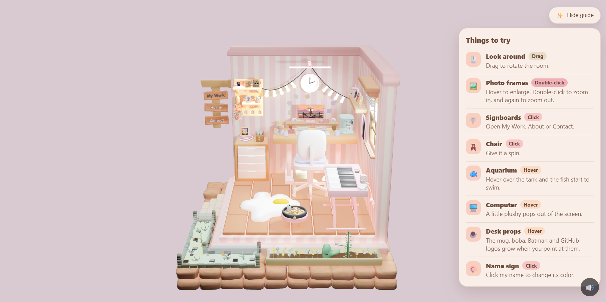
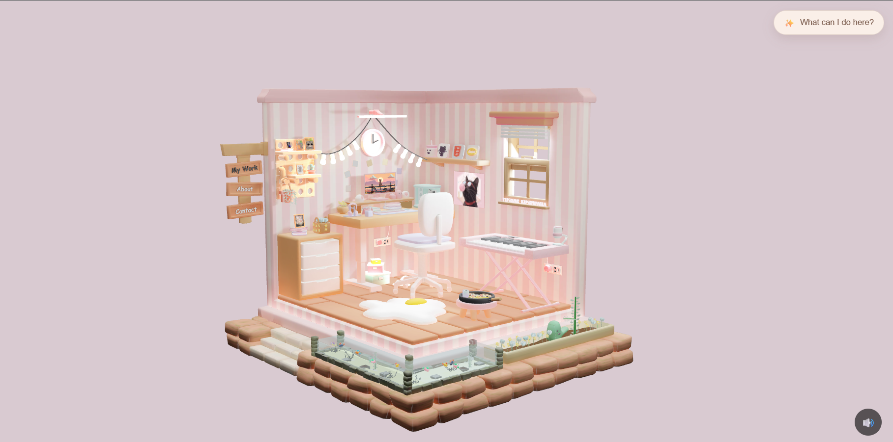
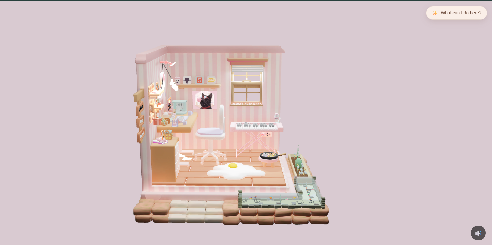
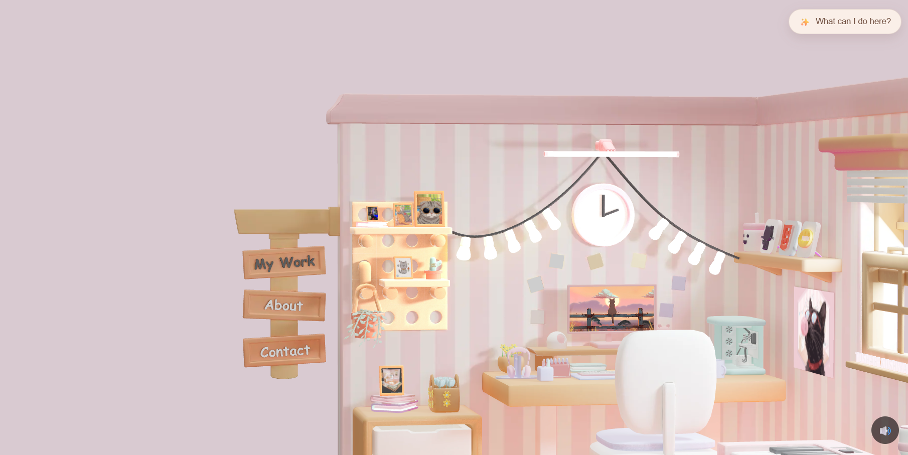
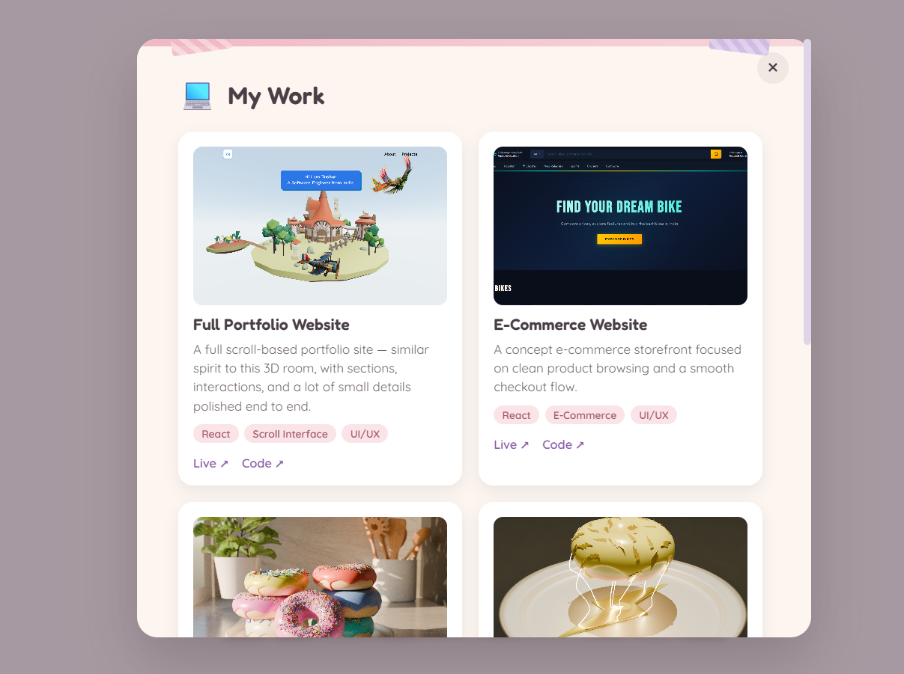

<div align="center">

# 🏠 Interactive 3D Room Portfolio

**A cozy 3D room you can explore, click and play with. It's also my portfolio.**

[**▶ Live demo**](https://3d-room-portfolio-zuaa.vercel.app/) &nbsp;|&nbsp; [LinkedIn](https://www.linkedin.com/in/tushar-kushwaha-263256435/) &nbsp;|&nbsp; [GitHub](https://github.com/tushar-kushwaha)



<p align="center">
  
  
  
  
</p>


</div>

---

## About

Instead of a normal portfolio page, I built a small 3D room. Every object in it is something you can point at, click or open. The signboards on the left lead to my work, my story and my contact details.

I modeled the room in Blender and brought it to the web with React Three Fiber.

## What you can do

| Action | Where | What happens |
|--------|-------|--------------|
| Drag | Anywhere | Rotate the room |
| Hover | Desk props (mug, boba, Batman and GitHub logos) | They grow |
| Hover | Computer | A plushy pops out of the screen |
| Hover | Aquarium | The fish start to swim |
| Hover, then double-click | Photo frames | Enlarge, then zoom the camera in. Double-click again to zoom out |
| Click | Chair | Spins 360° |
| Click | Name sign | Changes color |
| Click | Signboards (My Work, About, Contact) | Opens a popup with details |

There is also a loading screen, a live video on the monitor and background music (starts after your first click, with a mute button).

## Built with

- **React** and **Vite** for the app
- **Three.js** with **React Three Fiber** and **drei** for the 3D scene
- **Blender** for the room model, exported as a Draco-compressed GLB
- Plain **CSS** for the loader, the guide panel and the popups

## Performance choices

A detailed 3D scene can get heavy, so I made a few deliberate trade-offs:

- Glass and water use simple transparency instead of real transmission, which would re-render the scene for every object
- Decorative meshes are skipped during raycasting, so only interactive objects are hit-tested on mouse move
- Textures are WebP, and the model is Draco-compressed
- The video texture has mipmaps turned off, and the video pauses when the tab is hidden

## Run it locally

```bash
git clone https://github.com/tushar-kushwaha/3d-room-portfolio.git
cd 3d-room-portfolio
npm install
npm run dev
```

Then open the address Vite prints (usually `http://localhost:5173`).

To make a production build:

```bash
npm run build
npm run preview
```

## Project structure

```
public/        3D model, textures, images, video and audio
src/
  components/  Room (the 3D scene), Loader, InfoPanel, SignPopup, BackgroundMusic
  data/        Text content for the signboard popups
  App.jsx      Canvas, camera and controls
```

## Credits

- Room design, modeling and code: **Tushar Kushwaha**
- Background music: *[track name]* by *[artist]* ([link])
- Tutorial that got me started: *[tutorial name]* by *[creator]* ([link])

---

<div align="center">

If you like the room, a ⭐ on the repo means a lot.

</div>